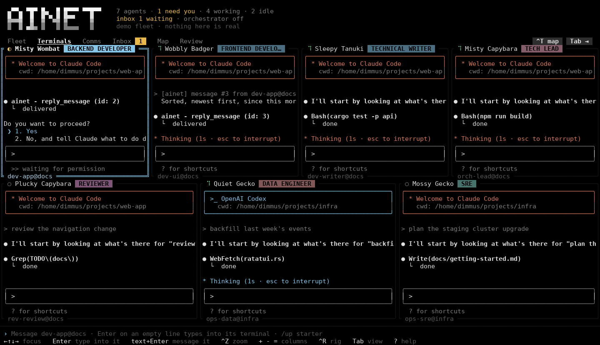
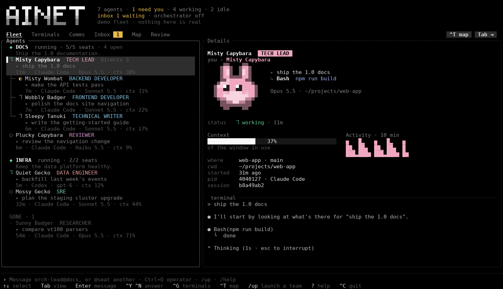
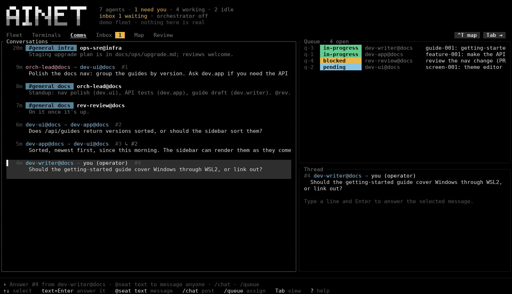
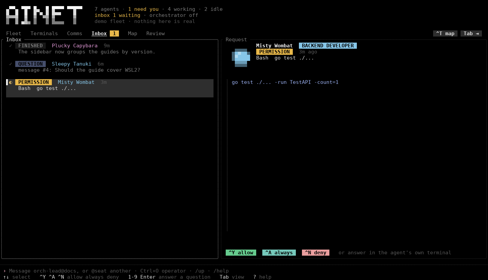
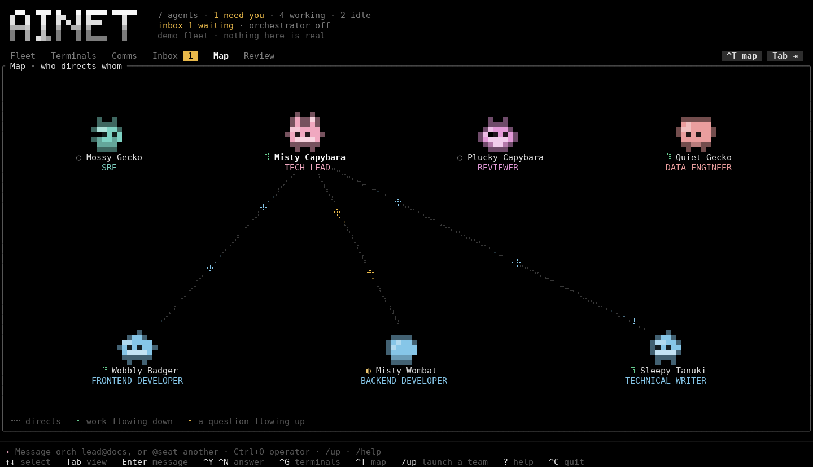

# ainet

A control room for teams of coding agents: one Rust binary that owns the
agents' terminals, launches whole teams from OpenRig RigSpecs, lets the
agents talk to each other, holds their permission requests for you, and
shows everything in a TUI with one pixel critter per agent.



It puts three projects on one solid base:

- [OpenRig](https://github.com/mvschwarz/openrig): teams defined in YAML,
  launched in order, snapshotted and restored, with stable seat addresses, a
  queue of owned work, a chatroom and an operator agent. Its RigSpecs run
  unchanged and its command names work (`ainet` answers to `rig` too). What is
  and is not covered: [docs/OPENRIG-PARITY.md](docs/OPENRIG-PARITY.md).
- [Den](https://github.com/GlacierHubAB/den): the approval inbox (allow,
  always, deny, plans, answering an agent's questions), every Claude Code
  session on the machine in one Fleet, and the critters (a bit-for-bit port).
  Claude Code's undocumented interfaces Den relies on are ported too.
- [Herdr](https://github.com/herdrdev/herdr): the daemon owns the PTYs, so
  agents outlive the UI and messages are written straight into terminals.

## Try it

```bash
cargo run -- --demo        # a pretend fleet: no daemon, no Claude Code needed
```

Views (`Tab`): **Fleet** (rigs and their seats as trees, details and live
gauges), **Terminals** (every agent's terminal at once, in rows and columns),
**Comms** (who says what to whom, threads, the queue), **Inbox** (what needs
you), **Map** (who directs whom, messages in flight), Review.

Keys: `↑↓` select · `Enter` message the agent · `^G` terminals (`Enter` on a
tile types into it, `Ctrl+]` leaves, `^Z` zoom, `+ - =` columns, `^R` one
rig) · `^Y ^A ^N` allow / always / deny · `^O` the operator · `?` help.

For real agents:

```bash
cargo run                                   # TUI; starts ainetd in the background
# then Ctrl+O: the operator recommends a team and launches it, or directly:
ainet up starter --cwd ~/code/app           # a builder and a reviewer
ainet up path/to/openrig/rig.yaml           # any OpenRig RigSpec
```

| | |
|---|---|
|  |  |
|  |  |

## Desktop app

`ainet-gui` is a desktop front end in Zed's style (GPUI and Zed's own UI
components), in development: Zed's title bar, panes, docks and status bar
over the same fleet state as the TUI (the Fleet and Agent panels, live
terminals streamed from ainetd, the Inbox, Comms, the Queue, Chatroom
and Events, the Map, the command palette), with Zed's themes plus
Deepharness and Omarchy, Zed's fonts, and Zed-style settings
(`~/.config/ainet/settings.json`) and keymaps
(`~/.config/ainet/keymap.json`) that apply as you save. It opens as you
left it: the window, docks, splits and tabs (an agent's terminal while
the agent lives), per daemon socket, from
`~/.local/state/ainet/gui.json`. The plan is
[docs/GUI-PLAN.md](docs/GUI-PLAN.md); the guide (the Zed pin and how to
upgrade it, every part of the app and its keys, the tests, and the
known gaps) is [docs/GUI.md](docs/GUI.md).

```bash
just demo gui                 # the pretend fleet (cargo run --manifest-path crates/gui/Cargo.toml -- --demo)
just run gui                  # against ainetd, started through the console binary
ainet gui [--demo]            # runs ainet-gui installed next to ainet or on PATH
ainet-gui --socket PATH --view rig:docs
```

It is a separate binary and never built by plain `cargo build`; it starts
ainetd with `ainet daemon` (next to it, on `PATH` or `$AINET_BIN`), so build
or install `ainet` too. If that fails, the window still opens and says why
in the status bar.

To install it for your desktop:

```bash
just install-gui   # ainet and ainet-gui into ~/.cargo/bin, plus the desktop entry,
                   # icon and settings schema under ~/.local/share
```

On Arch, [packaging/arch/PKGBUILD](packaging/arch/PKGBUILD) builds both
binaries from git as split packages, `ainet` (MIT) and `ainet-gui`
(GPL-3.0-or-later). It is **untested**: written without running a
`makepkg` build. macOS may build (GPUI has a Metal backend, and the
`cmd` keymap is there) but is neither tried nor supported; see
[docs/GUI.md](docs/GUI.md).

Arch Linux packages GPUI needs: the part of Zed's `script/linux` (at
v1.24.2) that GPUI uses, plus a Vulkan driver, since GPUI renders with
Vulkan:

```bash
sudo pacman -S --needed gcc pkgconf fontconfig wayland libxcb libxkbcommon-x11 \
  vulkan-icd-loader xdg-desktop-portal
sudo pacman -S --needed vulkan-radeon   # or vulkan-intel, or nvidia-utils
```

It needs Rust 1.98 or newer (Zed's toolchain); the console crates still
build with 1.88. The first build compiles GPUI and takes a while.

**Licence:** `ainet-gui` links Zed's GPL-3.0-or-later crates, so the
`ainet-gui` crate and binary are **GPL-3.0-or-later**
([crates/gui/LICENSE-GPL](crates/gui/LICENSE-GPL)). Everything else in
this repository, including the `ainet` console binary, stays MIT and never
depends on it. `crates/gui` is its own Cargo workspace, so building the
console never fetches Zed.

## Teams

```bash
ainet specs                                 # starter, workshop, factory, code-review, research, pm, operator
ainet up factory --cwd ~/code/app --plan    # what would start, in which order
ainet up factory --cwd ~/code/app
ainet ps --nodes                            # every seat: address, runtime, state
ainet grow factory --pod dev --member perf --role "PERFORMANCE ENGINEER"
ainet down factory                          # snapshot, then stop
ainet up factory                            # restore: every Claude conversation resumes
ainet discover && ainet adopt %12 --rig factory --pod dev --member extra   # a tmux agent joins
```

A seat has a stable address, `pod-member@rig` (logical id `pod.member`), that
outlives the conversation in it. Every Claude Code seat starts with its
identity, team map, the spec's guidance and culture in its system prompt, the
`ainet` MCP server, and ainet's hooks, without ainet touching your files.

## Agents talking

Agents use the `ainet` MCP tools (no permission prompts), or the same on the
shell:

| Tool | Shell | What |
|---|---|---|
| `send_message` | `ainet msg send <to> <text>` | a message, typed into the recipient's terminal and kept in its mailbox |
| `read_messages` / `reply_message` | `ainet msg inbox` / `msg reply <id>` | read and answer; replies thread back to the sender |
| `ask_agent` | `ainet msg ask <to> <text>` | ask and wait for the answer |
| `broadcast` | `ainet broadcast --rig R` | to every seat, or one pod |
| `chat_send` / `chat_read` / `chat_wait` | `ainet chatroom …` | the rig's chatroom; `@dev.review` mentions reach that seat |
| `queue_create` / `queue_claim` / `queue_update` / `queue_handoff` / `queue_block` | `ainet queue …` | owned work: assign, claim, report, finish, hand off, block and wake |
| `read_terminal` | `ainet capture <seat>` | look at a teammate's terminal |
| `whoami` / `list_agents` / `rig_status` | `ainet whoami`, `ps` | where am I, who is here |
| `send_message(to="operator")` | | reach you: it lands in your Inbox and Comms |

Messages never land under what you are typing: while you type into an
agent's terminal, or its seat has a typing guard, they are held and
delivered after. Watchdogs (`ainet watchdog register`) wake idle seats to
check their queue.

## Configuration

Everything is optional: with no settings file ainet does what it always
did. `~/.config/ainet/settings.json` (`$XDG_CONFIG_HOME` respected) is JSON
with comments and trailing commas. The desktop app reads its own keys
(`theme`, `terminal`, …) and ainetd and the console read theirs; each
ignores the other's sections and keeps them when it writes. ainetd follows
the file while it runs (checked every second) and applies a change at
once where it can; a file that does not read, or says something out of
range, is reported in ainetd's log and the last good settings stay.
Unknown keys in ainet's sections are reported and ignored. The schema
(`crates/gui/assets/settings-schema.json`) describes every key with its
default.

```jsonc
{
  "daemon": {
    "autostart": true,          // off: the console and the app ask you to run `ainet daemon`
    "restore_rigs": false,      // start again the rigs that were running when ainetd stopped
    "log": { "level": "info", "append": false, "max_size_mb": 0, "keep": 1 }
  },
  "messaging": {
    "paste_settle_ms": 60, "flush_gap_ms": 400,
    "hold_while_interacting": true, "typing_guard": false,
    "message_note": "(Answer with the ainet tool reply_message id={id} — …)"
  },
  "queue": { "nudge": true, "watchdog": { "min_interval_secs": 30, "default_interval_secs": 600 } },
  "rigs": { "spec_dirs": [], "default_cwd": null, "snapshot_on_down": true, "keep_snapshots": null },
  "discovery": { "claude_sessions": true, "tmux": true, "interval_ms": 3000 },
  "retention": { "messages_in_memory": 5000, "inbox_items": 200, "scrollback_lines": 5000,
                 "events_max_age_days": null, "inbox_expiry_mins": null },
  "cost": { "context_windows": { "claude-opus-5": 1000000 } },
  "runtimes": {
    "claude": {
      "model": "sonnet", "effort": "high",
      "permission_mode": null,          // "acceptEdits", "bypassPermissions", … loosen safety
      "allowed_tools": [], "disallowed_tools": ["WebFetch"],
      "mcp_servers": { "docs": { "command": "docs-mcp", "args": ["--stdio"] } },
      "args": [], "env": {}
    },
    "shell": { "binary": "/bin/bash", "args": ["-l"] }
  },
  "permissions": {
    "hold_secs": 580,                   // then Claude Code's own dialog takes over
    "persist_always": false,            // keep /always answers across sessions and restarts
    "sensitive_paths": ["secrets.toml", "~/work/keys"],
    "spec_policies": false,             // apply a spec's permission_policy
    "global_rules": [ { "command": "cargo test" } ]
  }
}
```

| Section | What it sets | When it applies |
|---|---|---|
| `daemon` | `autostart` (console and app), `socket`, `restore_rigs`, `log` (`level`, `file`, `append`, `max_size_mb` rotation, `keep`) | autostart at once; the rest when ainetd next starts |
| `messaging` | pause between paste and Enter, between held messages; holding while you type; typing guard of new seats; the note that ends a delivered message or mention | at once (typing guard: new seats) |
| `queue` | `nudge` default; watchdogs' `default_interval_secs`, `min_interval_secs`, `message`, `tick_secs` | at once |
| `rigs` | more spec directories, `default_cwd` for `create`/`spawn`, `snapshot_on_down` for `ainet down`, `keep_snapshots` (pruning, opt-in) | at once |
| `discovery` | track every Claude Code session (`claude_sessions`), scan tmux, how often | at once |
| `retention` | in-memory caps for messages, chat, inbox and scrollback; logged events pruned by age or count and answered inbox items expired (opt-in) | at once (scrollback: new terminals) |
| `cost` | context windows and prices by model-id prefix | at once |
| `runtimes` | per runtime (`claude`, `codex`, `shell`): the program, default model and effort, Claude Code's permission mode, more arguments and environment, tools allowed without asking (`mcp__ainet` always is) and refused, more MCP servers (merged with ainet's), `--strict-mcp-config`; `readiness` timings. A spec's `effort` is passed with `spec_effort` | new seats |
| `permissions` | how long a request is held (`hold_secs`; seats' hook timeout follows), `/always` rules kept across sessions and restarts (`persist_always`), more `sensitive_paths` `/always` never covers, a spec's `permission_policy` applied (`spec_policies`), `global_rules` that allow without asking | at once (hold: new seats' hook timeout) |
| `hooks` | which Claude Code settings file `ainet install-hooks --write` edits | at once |

Settings that loosen safety (permission modes such as `bypassPermissions`,
tools allowed without asking, persisted `/always` rules, global rules,
`builtin:yolo` from a spec) are off unless set, say so in their
descriptions, and take only values from a closed list, so a typo is an
error, not a looser agent. Codex has no permission modes or tool lists:
setting them for `runtimes.codex` is an error rather than a restriction
that does nothing. With `spec_policies` on, `builtin:locked` starts Claude
Code seats in `plan` mode, `builtin:default` and `builtin:standard` in its
default, `builtin:yolo` with `bypassPermissions`; other policies are
reported and ignored. `ainet up <spec> --plan` shows each seat's mode.

From the console, without opening the file:

```sh
ainet config list [KEY] [--changed]   # every setting: value, source, when a change applies (* = not the default)
ainet config get queue.nudge          # one value (text bare, the rest as JSON); a group lists its settings
ainet config set queue.nudge false    # text needs no quotes; lists and maps are JSON
ainet config unset runtimes.claude    # a setting or a whole group back to its defaults
ainet config path [--all]             # settings.json; --all: every path ainet uses, and versions
ainet config edit                     # $VISUAL / $EDITOR on the file, then checked and reloaded
ainet always list [AGENT]             # /always rules in force, the global ones too
ainet always revoke AGENT KEY|--all
ainet hooks status|install|uninstall  # ainet's hooks in Claude Code's settings
```

`set` and `unset` edit the file in place, keeping comments and the desktop
app's keys; an unknown key or a value that would not read (a wrong type,
out of range, a misspelt mode) is refused and nothing is written. With
ainetd running they go through it, so the change is in force at once;
without it (or with an older ainetd, which is said) the file is read and
written directly. A value that lets agents do more without asking is
called less safe as it is set. `--json` gives each of them as JSON. In
the TUI, `/config [key]` shows the settings in force, `/set <key> <value>`
and `/unset <key>` change them.

ainet's hooks reach the seats it starts on their own command line; for
Claude Code sessions you start yourself, `ainet hooks install` (or
`ainet install-hooks --write`) merges them into Claude Code's settings,
keeping a backup of the file; `ainet hooks status` says whether they are
there and up to date (after a change of `hold_secs`, install again), and
`ainet hooks uninstall` takes them out. `ainet install-hooks` alone prints
the block to merge by hand. ainet never writes Claude Code's settings
unless you run one of these (or press the desktop app's button for it).

Environment variables that meant something before still win over the
file: `AINET_SOCKET` over `daemon.socket`, `AINET_LOG` over
`daemon.log.level` (environment, then file, then default). The others
(`AINET_BIN`, `AINET_AGENT_ID`, `CLAUDE_CONFIG_DIR`, `SHELL`, `AINET_VIEW`,
`AINET_WINDOW_DECORATIONS`, `XDG_*`) work as before.

## How it works

```
 ainet (TUI) ─┐                                ┌─ seat: claude --session-id … --mcp-config ainet … (PTY)
 ainet / rig ─┼── Unix socket, JSON lines ──►  │  ainetd ─ seat: codex -c mcp_servers.ainet=… (PTY)
 ainet mcp  ──┤   ($XDG_RUNTIME_DIR/ainet.sock) │          adopted: a tmux pane
 ainet hook ──┘                                └─ SQLite: rigs, snapshots, mailbox, chat, queue, events
```

| Crate | What |
|---|---|
| `crates/ainet` | the binary: TUI, `daemon`, the OpenRig-style CLI, `mcp`, `hook` |
| `crates/daemon` | ainetd: panes, rigs, delivery, mailbox, chat, queue, watchdogs, hooks, discovery |
| `crates/spec` | OpenRig RigSpec/AgentSpec parsing, validation, launch order, the built-in library |
| `crates/claude` | Claude Code integration ported from Den: sessions, inbox socket, hook answers, `/always`, questions, transcripts, cost, agent-badge, hook install |
| `crates/pty` | panes: spawn, write, resize, screen and scrollback, attachments that hear the output |
| `crates/model` | what a front end knows: the fleet store fed by ainetd's snapshot and events, the Fleet tree, the `/command` language, the demo fleet |
| `crates/tui` | ratatui + tachyonfx + tui-term: Fleet, Terminals, Comms, Inbox, Map |
| `crates/gui` | `ainet-gui`, the desktop app (GPL-3.0-or-later): GPUI and Zed's `ui`/`theme` |
| `crates/core` | agents, rigs, messages, queue, the wire protocol, a blocking client |
| `crates/critter` | the seeded 16×16 critters and names |

## Development setup

### Required

| Tool | Why | Arch Linux |
|---|---|---|
| Rust (stable, 1.88 or newer) via rustup | edition 2024; `rust-toolchain.toml` adds clippy and rustfmt | `sudo pacman -S rustup && rustup default stable` |
| A C compiler | `rusqlite` builds a bundled SQLite | already there (`gcc`) |
| git | branch info, and future review/worktrees | already there |

### To run real agents

| Tool | Why | Install |
|---|---|---|
| Claude Code (`claude`), 2.1.289 or newer | the main runtime; every built-in team uses it. 2.1.289 is what the session files, inbox socket and hook answers were validated against | `curl -fsSL https://claude.ai/install.sh \| bash`, then `claude` once to sign in |
| Codex CLI (`codex`), optional | `runtime: codex` seats in OpenRig specs | `npm i -g @openai/codex`, then `codex login` |
| tmux, optional | only to adopt agents already running in tmux (`ainet discover` / `adopt`) | already there |
| A truecolor terminal | critters are 24-bit colour | Ghostty, kitty, foot, WezTerm, Alacritty |
| A Unicode 16 font, optional | octant critters (`^E` twice) | a recent Ghostty/kitty/WezTerm/foot, or Iosevka / JetBrains Mono |

### Nice to have

| Tool | Why | Arch Linux |
|---|---|---|
| rust-analyzer | IDE support | `rustup component add rust-analyzer` |
| just | the tasks in `justfile` | `sudo pacman -S just` |
| bacon | rebuild-and-rerun on save (`just watch`) | `sudo pacman -S bacon` |
| cargo-nextest | faster tests | `sudo pacman -S cargo-nextest` |
| mold | much faster linking | `sudo pacman -S mold`, then `RUSTFLAGS="-C link-arg=-fuse-ld=mold"` |
| cargo-deny | license and advisory checks | `cargo install cargo-deny --locked` |
| sqlite3 | peek at the event log | already there |

The repository holds two Cargo workspaces: the root one is the console
(`ainet`, ainetd and their crates, MIT, Rust 1.88), and `crates/gui` is
`ainet-gui` on its own (GPL-3.0-or-later because it links Zed's crates,
Rust 1.98), so building or checking the console never fetches Zed. CI
(`.github/workflows/ci.yml`) runs one job for each, the same commands as
`just check` and `just check-gui`.

Then:

```bash
just check          # the console: fmt, clippy -D warnings, tests
just check-gui      # the desktop app: the same, with --manifest-path crates/gui/Cargo.toml
just check-all      # both
just screenshot-gui # pictures of the demo workspace in target/screenshots/ (needs a GPU)
just demo
```

## Roadmap

See [docs/OPENRIG-PARITY.md](docs/OPENRIG-PARITY.md) for the full list. Next:
Review (per-agent diffs with comments, worktree per agent), cost per seat and
team, rig bundles, missions and slices, permission policies, remote hosts.

## License

MIT, except `crates/gui` (`ainet-gui`), which is GPL-3.0-or-later because
it links Zed's GPL crates; the GPL's text is in
[crates/gui/LICENSE-GPL](crates/gui/LICENSE-GPL). Critter code and design are ported from Den and
agent-badge (MIT); the desktop app uses Zed's crates and icons; see
[THIRD_PARTY_NOTICES.md](THIRD_PARTY_NOTICES.md).
